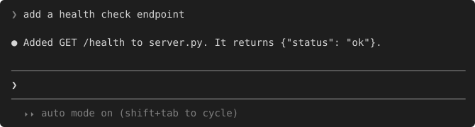
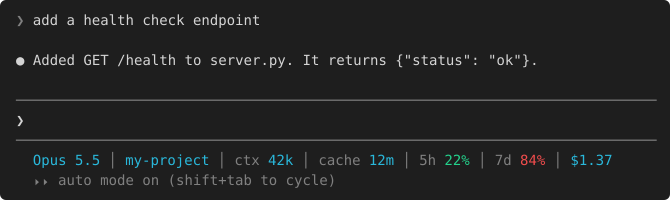
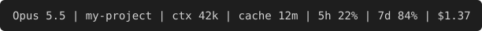
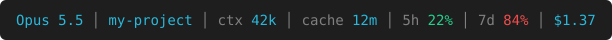
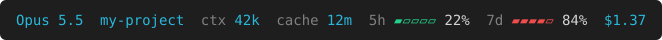
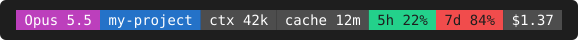
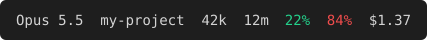

# Claude Status Bar

A one-line status bar for Claude Code that shows the model, project, context size, cache timer, 5-hour and 7-day usage limits, and session cost.

**Before**



**After**



## Install

You need Python 3.8+.

**Windows (PowerShell)**
```powershell
irm https://raw.githubusercontent.com/MainMi/Claude-Status-Bar/main/statusbar.py -OutFile $env:TEMP\statusbar.py; python $env:TEMP\statusbar.py
```

**macOS / Linux**
```sh
curl -fsSL https://raw.githubusercontent.com/MainMi/Claude-Status-Bar/main/statusbar.py -o /tmp/statusbar.py && python3 /tmp/statusbar.py
```

Pick a design and the segments you want, then restart Claude Code. Run the same command again to **reinstall** or **remove** it. Removing it puts back your previous status line.

## Designs

| Design | Preview |
|---|---|
| `plain` |  |
| `color` |  |
| `bars` |  |
| `blocks` |  |
| `minimal` |  |

Usage limits turn green, yellow, or red at 50% and 80%. Each segment can be turned off: `model`, `project`, `context`, `cache`, `5h`, `7d`, `cost`.

## Privacy

No data is collected or stored. The script reads what Claude Code passes to it, prints one line, and sends nothing over the network. The only file it keeps is your settings: design, segments, and previous status line.

## Open source

The project is 100% open source under the [Apache 2.0 license](LICENSE). The whole status bar is one file, `statusbar.py`, so you can read all of it before you install.

If you find it useful, please give the repository a star on GitHub.
